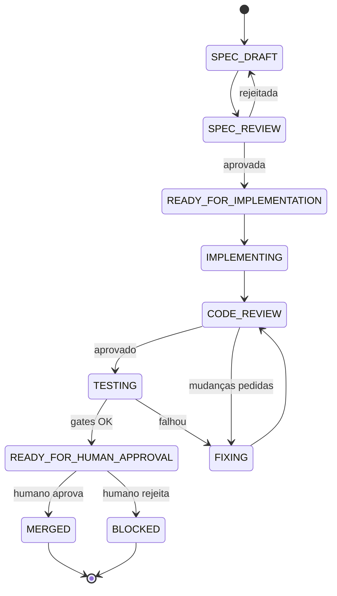
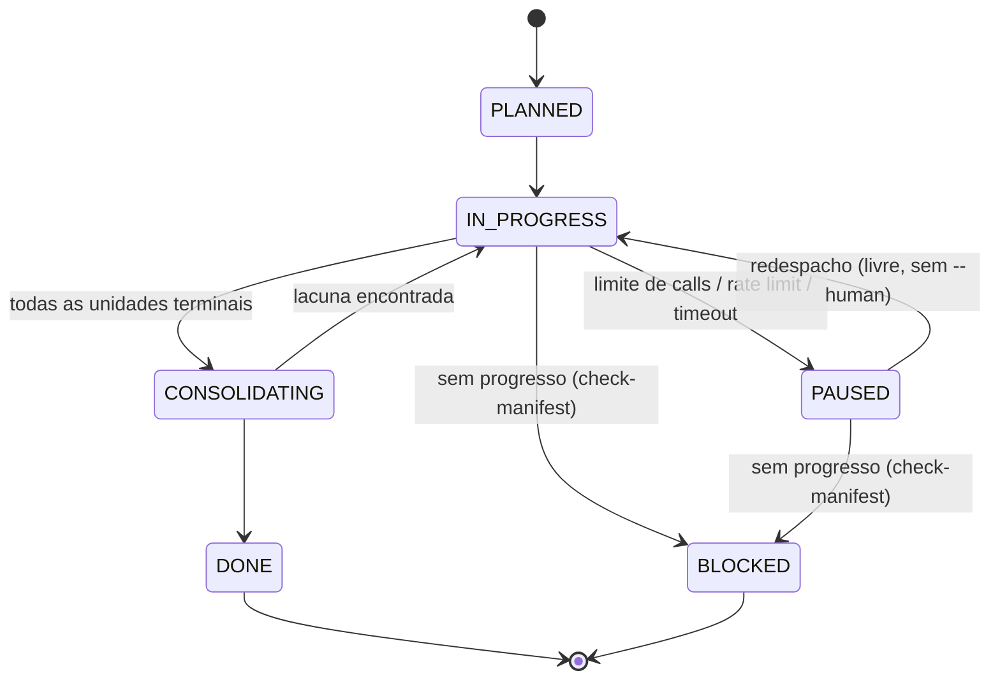

# Protocolo `.ai/` — coordenação por artefatos

> Este arquivo é copiado/referenciado como `.ai/README.md` no projeto consumidor.
> É o contrato legível por humano — a fonte da verdade do protocolo. Qualquer
> agente (Claude Code, Codex, OpenCode, Antigravity, Pi e outros) deve ler isto
> antes de assumir um papel na task. Ordem de leitura: `AGENTS.md` → `.ai/MEMORY.md` → este arquivo; se o projeto tiver `CLAUDE.md` ou outro arquivo de convenções (opcional — se existir, leia também; se não existir, siga sem ele).
> (`.ai/MEMORY.md` guarda stack/comandos/preferências do projeto; nunca contém segredos.)

## Por que isso existe

Agentes de IA não compartilham janela de contexto. Entre ferramentas diferentes,
a única comunicação confiável é **artefato versionado no repositório** — um
arquivo que um agente escreve e o próximo lê na sessão seguinte.

## Máquina de estados



Estados terminais: `MERGED`, `BLOCKED` (`BLOCKED` só reabre com `--human` em
`validate-task-state.mjs` — decisão humana explícita).

## Máquina de estados — tasks de documentação/pesquisa

Tasks com `type: "doc" | "research"` usam uma máquina própria, desenhada para
subagentes com limite de chamadas: **limite atingido é pausa retomável, nunca
falha terminal**.



O trabalho é decomposto num **manifesto de unidades atômicas** (campo `units`
no task contract — ver `TEMPLATE-DOC.json`): 1 fonte/página/seção = 1 unidade,
com output gravado em arquivo assim que a unidade termina. Retomar = redespachar
apontando o manifesto; o worker pula o que está `done`. Não importa por que o
agente morreu — o redespacho é sempre idêntico e idempotente.

- Papel executor: `.estrutura/ai-protocol/skills/doc-worker.md` (máx.
  `max_units_per_agent` unidades por despacho, fail-fast em fontes quebradas).
- Gate de cobertura/retomada:
  ```bash
  node .estrutura/ai-protocol/gates/check-manifest.mjs DOC-XXX --checkpoint
  ```
  Exit 0 = redespachar | 1 = `BLOCKED` (esgotou `max_resumes_without_progress`
  redespachos sem progresso) | 3 = completo, ir para `CONSOLIDATING`.
- `PAUSED` exige manifesto atualizado + `note` com a causa (e `retry_after`
  quando conhecido, p/ retomada agendada via loop/cron).

## Estrutura de arquivos (no projeto consumidor)

```
.ai/
├── README.md            ← este arquivo
├── .gitignore            ← só ignora tmp/
├── tasks/
│   ├── TEMPLATE.json
│   └── FEATURE-XXX.json ← 1 por feature em andamento
├── reports/
│   ├── FEATURE-XXX-spec-review.md
│   ├── FEATURE-XXX-worker.md
│   ├── FEATURE-XXX-review.md
│   └── FEATURE-XXX-test.md
└── events.jsonl          ← log append-only, 1 linha JSON por evento
```

Os scripts (`gates/`), templates (`templates/`) e skills por papel (`skills/`)
**não são copiados** — ficam no submodule (`.estrutura/ai-protocol/`) e são
referenciados a partir daí, para não haver duas cópias divergentes.

## Task contract

Ver `.estrutura/ai-protocol/tasks/TEMPLATE.json`. Campos-chave:

- `allowed_paths` — quais mudanças pertencem à task (usado pelo gate anti-silêncio).
- `required_checks` — comandos reais, rodados via `execSync` (nunca "confiar que passou").
- `max_fix_cycles` / `fix_cycles_used` — na 3ª falha (`FIXING → CODE_REVIEW` ou
  `TESTING → FIXING` esgotados), a task deve ir para `BLOCKED`.
- `worktree` — default é `"."` (trabalha direto na raiz do repo, sem pasta
  isolada). Isso é suficiente sempre que só 1 agente por vez toca código no
  projeto (o caso comum). Só use um path separado quando **de fato** houver
  mais de um agente/task com código em andamento ao mesmo tempo — nesse caso,
  namespace pelo nome da pasta do repo, nunca um path genérico:
  `../<nome-do-repo>-worktrees/<branch>`. Um path genérico tipo
  `../worktrees/<branch>` quebra quando o repo vive num diretório-pai
  compartilhado com outros projetos (comum: `~/code/`, `E:/Project/`, etc.) —
  dois repos diferentes acabam escrevendo no mesmo caminho.

## Transicionar estado

```bash
node .estrutura/ai-protocol/gates/validate-task-state.mjs FEATURE-XXX CODE_REVIEW --actor=worker --note="implementacao concluida"
```

- Exit 0 = transição válida e aplicada (contrato atualizado + evento logado).
- Exit 1 = transição inválida na máquina de estados, ou ciclos de fix esgotados.
- Exit 2 = erro de uso / task não encontrada.

## Rodar os gates antes de avançar

```bash
node .estrutura/ai-protocol/gates/check-gates.mjs FEATURE-XXX
```

Roda, nesta ordem:

1. **`required_checks`** — comandos reais via `execSync`, nunca "confiar que passou".
2. **Artefatos obrigatórios do estado atual** — existem **e estão preenchidos**:
   placeholders `{{...}}` do template substituídos, veredito marcado com `[x]` e
   toda pergunta `Sim/Não —` respondida. Template copiado e não preenchido
   **reprova** — antes disso, o gate só provava que um arquivo existia.
   Nos reports `worker` e `test`, a **tabela de comandos** também é checada:
   precisa existir, ter linha preenchida, exit code numérico e output real —
   `ok`/`passou`/`ver CI` reprovam; comando sem output declara `(sem saída)`.
   Checa só a forma: output inventado não é detectável aqui (quem pega é o
   passo 1, que re-executa os comandos).
3. **Gate anti-silêncio** — compara `mtime` dos arquivos em `allowed_paths` com o
   timestamp do último evento da task; se código mudou depois do último evento
   registrado, o gate **falha**, forçando o agente a logar antes de prosseguir.
4. **Verificação semântica via Jev** *(opcional, desligada por default)* — ver abaixo.

O passo 2 pode ser afrouxado item a item em `.estrutura.config.json`
(`reportChecks`: `placeholders`, `verdict`, `answers`, `evidence`), mas o
default é estrito: **chave ausente = checagem ligada**.

Testes de regressão do gate: `node --test ai-protocol/gates/tests/` (sem
dependências, só `node:test`).

### Camada opcional: verificação semântica (Jev)

Os passos 1–3 são locais e determinísticos. O passo 4 manda o conteúdo dos
reports para um serviço externo ([typesafe.ai](https://docs.typesafe.ai)) para
julgar o que regex não vê — por exemplo, se o report **prova** com saída real de
comando ou apenas **afirma** que funciona.

Por isso é **opt-in explícito por projeto** (`"jev": { "enabled": true }`): um
`git submodule update --remote` nunca pode começar a exportar conteúdo do
projeto em silêncio. Roda em **modo advisory** — sinaliza no stdout e loga em
`events.jsonl`, mas **nunca muda o exit code**.

A API key **nunca** vai em arquivo do projeto (`.estrutura.config.json` é
commitado). Ela vem da variável de ambiente `JEV_API_KEY`, definida uma vez na
máquina e válida para todos os projetos:

```bash
# Windows (PowerShell, permanente) — reabra o terminal/VSCode depois
[Environment]::SetEnvironmentVariable('JEV_API_KEY','<key>','User')

# Linux/macOS (bash/zsh, permanente)
echo 'export JEV_API_KEY="<key>"' >> ~/.bashrc && source ~/.bashrc
```

Sem a key, o gate imprime as instruções acima e segue normalmente. Se a chamada
falhar (timeout, 5xx, 429), o veredito fica com as camadas 1–3 e a indisponibilidade
é registrada em `events.jsonl` — nunca vira aprovação silenciosa.

## `events.jsonl` — o gatilho

Uma linha JSON por evento:

```json
{"ts": "<ISO>", "action": "STATE_TRANSITION", "task": "FEATURE-XXX", "from": "CODE_REVIEW", "to": "FIXING", "actor": "worker", "note": "..."}
```

`action` ∈ `STATE_TRANSITION | REPORT_CREATED | REPORT_UPDATED | TASK_CREATED | VERIFICATION | UNIT_DONE | MANIFEST_CHECKPOINT`.
É o único "sinal" que diz a outro agente "aconteceu algo, releia os artefatos".

## Papéis

| Papel          | Pode alterar código?           | Saída obrigatória                             | Skill                                          |
| -------------- | ------------------------------- | ---------------------------------------------- | ----------------------------------------------- |
| Arquiteto/SPEC | Não (só docs)                   | spec em `.specs/` + task contract `SPEC_DRAFT` | `.estrutura/ai-protocol/skills/orchestrator.md` |
| Worker         | Sim, só no worktree da task      | `.ai/reports/FEATURE-XXX-worker.md` + commit   | `.estrutura/ai-protocol/skills/dev-worker.md`   |
| Revisor        | Não — só reporta                | `.ai/reports/FEATURE-XXX-review.md`            | `.estrutura/ai-protocol/skills/code-reviewer.md`|
| QA             | Só testes, se autorizado        | `.ai/reports/FEATURE-XXX-test.md`              | `.estrutura/ai-protocol/skills/qa-gate.md`      |
| Doc Worker     | Não (só docs em `output_dir`)   | outputs por unidade + manifesto atualizado     | `.estrutura/ai-protocol/skills/doc-worker.md`   |
| Orquestrador   | Não — só decide o próximo passo | nada, só relata                                | `.estrutura/ai-protocol/skills/orchestrator.md` |
| Humano         | Sim, por merge                  | aprova ou `BLOCKED`                            | —                                                |

## Regras fixas do protocolo

- 1 agente por worktree por vez.
- Revisor nunca corrige — só reporta (arquivo, linha, severidade, reprodução).
- Máx. `max_fix_cycles` ciclos automáticos `FIXING → CODE_REVIEW`; na falha seguinte → `BLOCKED`, decisão humana.
- Sem merge/push/deploy/migration de produção sem aprovação humana.
- "Parece funcionar" nunca é evidência — exige saída real de comando com exit code (é por isso que `check-gates.mjs` roda os comandos de verdade).

## Memória: `.ai/MEMORY.md` x `elyra mem`

- `.ai/MEMORY.md` é a fonte VERSIONADA de fatos do projeto (stack, comandos,
  convenções; todos os agentes de qualquer ferramenta leem).
- `elyra mem` é complementar, local ao Elyra deste computador e NÃO
  versionado: use para preferências pessoais, decisões de sessão e fatos que
  valem entre projetos (escopo global).
- Fato importante de projeto vai no `MEMORY.md` (e pode ser espelhado com
  `elyra mem --scope project`). Nunca segredos em nenhum dos dois.
